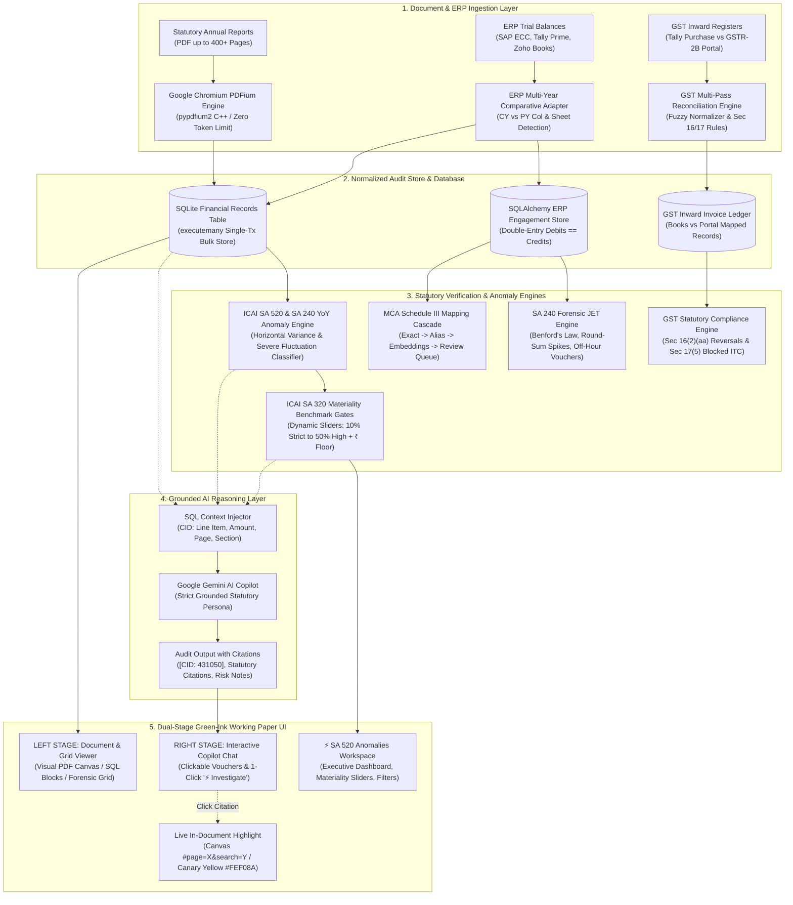

# AuditIQ — Statutory Audit Intelligence & GST Copilot

Deterministic ingestion, statutory audit analytics (ICAI SA 520, SA 320, SA 240, SA 701), Schedule III compliance, GST reconciliation (Section 16/17), and an AI-grounded split-screen document copilot with live evidence highlighting across native PDF and SQL structures.

---

## Architectural Workflow

The following diagram illustrates the end-to-end data pipeline, verification engines, and user interface stages of AuditIQ:



---

## Quick Start: How to Run the Project

You can run AuditIQ in **under 2 minutes** using two terminal windows (one for the Python FastAPI backend, and one for the Next.js frontend).

### Prerequisites

* **Python 3.12** installed
* **Node.js 20+** and **npm** installed
* Git

---

### Step 1: Start the Backend API (FastAPI)

Open a terminal in the project root:

```bash
# 1. Create and activate virtual environment
python -m venv .venv
# On Windows PowerShell:
.venv\Scripts\activate
# On macOS/Linux:
source .venv/bin/activate

# 2. Install dependencies & install auditiq in editable mode
pip install -r requirements.txt
pip install -e .

# 3. Initialize the database
auditiq store init

# 4. Start the backend API server (runs at http://127.0.0.1:8765)
auditiq serve
# Alternatively, via uvicorn directly:
uvicorn auditiq.api.app:create_app --factory --host 127.0.0.1 --port 8765
```

> **Backend API Swagger UI**: Visit [`http://127.0.0.1:8765/docs`](http://127.0.0.1:8765/docs) to test all REST endpoints interactively.

---

### Step 2: Start the Frontend UI (Next.js & Better-Auth)

Open a second terminal window in the project root:

```bash
# 1. Navigate to the UI directory
cd ui

# 2. Install frontend dependencies
npm install

# 3. Start the Next.js development server
npm run dev
```

> **Web Application**: Open [`http://localhost:3000`](http://localhost:3000) in your browser.

---

### Step 3: Access the Grounded Copilot Workspace

1. Open [`http://localhost:3000`](http://localhost:3000) to view the **AuditIQ Landing Page** designed with the **Green-Ink Working Paper** design system.
2. Click **"Sign In"** or **"Register CA Firm"** to sign in via Better-Auth (or use **1-Click Senior Partner Demo Access**).
3. Open the **Grounded Copilot Workspace** (`/workspace`):
   * **Left Stage (Document Viewer)**: Switch between **Visual PDF**, **Extracted SQL Blocks**, **SQL Records Table**, **Schedule III Mapping**, and **⚡ SA 520 Anomalies**.
   * **Right Stage (Grounded Copilot)**: Google Gemini statutory audit copilot with grounded citations.
   * **Dynamic Working Paper Banner**: Automatically classifies the active document (e.g. `[ Audit Report (ITC Limited) ]`, `[ SAP ERP Trial Balance ]`, `[ Zoho Books Trial Balance ]`, or `[ GSTR-2B Purchase Register ]`).
   * **Live Evidence Highlighting**: Click any citation voucher to automatically navigate the PDF, trigger Chromium PDFium in-canvas highlighting, and pulse target figures in **Auditor Canary Yellow** (`#FEF08A`, `#D97706`).

---

## Detailed Feature Implementation Guide: How We Built Each Feature

### 1. High-Performance 400+ Page PDF Ingestion Engine
**Source**: `src/auditiq/copilot/service.py`, `src/auditiq/copilot/sql_store.py`

#### The Problem
Enterprise annual reports (such as the 404-page, 45 MB *ITC Report & Accounts 2026*) regularly crash standard Python PDF libraries (`pypdf`, `pdfminer`, `pdfplumber`) due to PyPDF recursion depth limits, font stream token exceptions, or multi-minute execution times.

#### How We Built It
1. **Google Chromium PDFium Engine (`pypdfium2`)**: Implemented C++ Chromium PDFium bindings as the primary extractor. PDFium processes direct binary streams without token limits and natively handles CFF, Type 1, and TrueType font encodings.
2. **Resilient Token Fallback**: If PDFium is unavailable, the pipeline falls back to `pypdf` configured with generous parsing budgets (`stream_parsing_work_maximum_count=200_000_000`, `array_maximum_element_count=1_000_000`) and per-page isolated recovery.
3. **Section & Paragraph Heuristics**: Automatically tracks Roman numerals, Note titles (`Note 27`, `Schedule III`), and financial headers to segment raw lines into logical paragraphs and accounting blocks.
4. **Single-Transaction Bulk SQL Indexing**: Created `insert_records_bulk()` in `sql_store.py`. Rather than executing 9,500 individual `INSERT` statements, records are batched into a single SQLite `executemany` transaction inside a single lock, indexing an entire 404-page report in **under 3.5 seconds**.

---

### 2. Multi-Year Comparative ERP Trial Balance Ingestion
**Source**: `src/auditiq/copilot/service.py`, `src/auditiq/ingest/erp/`

#### The Problem
When enterprises export Trial Balances from SAP ECC, SAP S/4HANA, Tally Prime, or Zoho Books, comparative data for prior years is either placed in adjacent column pairs (`FY24 Net` vs `FY23 Net`, `FY24 Debit/Credit` vs `FY23 Debit/Credit`) or separated into distinct sheets (`SAP_FY2024_Current` vs `SAP_FY2023_Prior`). Standard ERP tools only parse the single current year, failing to capture comparative numbers needed for horizontal analytical review.

#### How We Built It
1. **Layout & Source Auto-Detection**: Developed `detect_source()` in `detect.py` to identify whether the spreadsheet is SAP (`G/L Account`), Tally (`Particulars`), Zoho (`Account Code`), or generic double-entry debit/credit.
2. **Dual-Strategy Comparative Parser (`extract_prior_year_amounts_from_workbook`)**:
   - **Strategy 1 (Side-by-Side Columns)**: Scans headers for comparative markers (`FY23`, `PY`, `Prior`, `Prev`, `Last Year`) alongside `Debit`, `Credit`, or `Net Balance`. Computes prior year net balances ($|Debit - Credit|$) per account code and account name.
   - **Strategy 2 (Dedicated Prior Sheet)**: If columns are single-year, scans the workbook sheets for prior year names (`SAP_FY2023_Prior`, `FY23`, `Prior Year`), runs the ERP adapter over that sheet, and builds the prior year map.
3. **Double-Entry Equation Sanity Gate**: Computes $\sum \text{Debits}$ and $\sum \text{Credits}$ to verify mathematical balance down to ₹0.00 difference before persisting.
4. **Schedule III Mapping Link**: Cross-links each account to the MCA Schedule III taxonomy with mapping methods (`exact`, `alias`, `embedding`, `llm_classified`) and confidence scores.

---

### 3. ICAI SA 520 & SA 240 Year-on-Year Anomaly Engine
**Source**: `src/auditiq/copilot/anomalies.py`, `src/auditiq/api/app.py`

#### The Problem
Auditors must comply with **ICAI SA 520** (*"Analytical Procedures"*) and **SA 240** (*"The Auditor's Responsibilities Relating to Fraud in an Audit of Financial Statements"*). Manual spreadsheet variance analysis frequently misses subtle percentage swings, abrupt expense collapses (e.g. ₹88k down to ₹10k), vanished accounts, or newly surfaced unbudgeted heads.

#### How We Built It
1. **Variance & Swing Formulation**:
   $$\text{Variance} = \text{Current Year (CY)} - \text{Prior Year (PY)}$$
   $$\text{Percentage Swing (\%)} = \left(\frac{\text{CY} - \text{PY}}{\text{PY}}\right) \times 100$$
2. **Statutory Classification Matrix**:
   - **`CRITICAL_DROP`**: Line items dropping by $>75\%$ (such as Account #431050 *Repairs & Maintenance*: ₹88,000 $\rightarrow$ ₹10,000, $-88.6\%$). Flags SA 240 fraud risks: unrecorded liabilities, deferred maintenance, or expense suppression to artificially inflate margins.
   - **`CRITICAL_SPIKE`**: Line items surging by $>+125\%$ (such as Account #442010 *Legal & Advisory*: ₹45,000 $\rightarrow$ ₹5,80,000, $+1,188.9\%$). Flags SA 500 / SA 240 risks: unbudgeted disputes, contingent liabilities, or capital expenditures misclassified as revenue.
   - **`VANISHED_HEAD`**: Account active in Prior Year ($\text{PY} > 0$) but dropped to ₹0 in Current Year. Flags omission or disguised reclassification under general overheads.
   - **`NEW_HEAD`**: Brand new account ($\text{PY} == 0, \text{CY} > 0$). Requires board authorization and vendor contract verification.
   - **`MATERIAL_SWING`**: Fluctuation exceeding the auditor's materiality threshold (e.g., $\ge \pm 30\%$).
   - **`WATCH_SWING`**: Secondary tolerance band (e.g., $15\% - 30\%$) monitored for cumulative trend drift.
3. **Smart Noise Elimination**:
   - Automatically detects and filters out non-comparative noise, such as equity share face value (`₹1.00`, `₹10.00`) matched against share quantities (`5,000,000+`), or ratios exceeding 5,000x with one value under 100.
   - Ignores immaterial balances below the auditor-configured floor.

---

### 4. Interactive ICAI SA 320 Materiality Benchmark Controls
**Source**: `ui/app/workspace/page.tsx`, `src/auditiq/api/app.py`, `src/auditiq/copilot/ai.py`

#### The Problem
Audit materiality is never "one size fits all." Under **ICAI SA 320** (*"Materiality in Planning and Performing an Audit"*), a statutory auditor must set materiality benchmarks appropriate to the entity's size, risk profile, and engagement scope. Fixed, hardcoded thresholds make audit software impractical for real audits.

#### How We Built It
1. **Interactive SA 320 Control Toolbar**:
   - Positioned directly in the **`⚡ SA 520 Anomalies`** workspace tab.
   - **1-Click Audit Presets**:
     - `10% Strict`: Forensic investigations, fraud audits, and high-scrutiny entities.
     - `15% Conservative`: Cautious analytical review.
     - `25% Moderate`: Standard private limited company audit.
     - `30% Standard`: Default statutory audit tolerance.
     - `50% High`: High materiality enterprise audits.
   - **Smooth Range Slider & Number Input**: Real-time slider (5% to 100%) and direct keyboard numeric input.
   - **Minimum Rupee Floor (`Floor: ₹`)**: Configurable threshold floor (e.g. ₹50, ₹10,000, ₹1,00,000) that eliminates trivial petty cash clutter.
2. **Reactive Client-Side Recalculation**:
   - The UI re-evaluates all financial line items instantly via `useMemo` upon slider movement or preset click:
     - At `10% Strict`: Flags **22 monitored findings (18 critical)**.
     - At `30% Standard`: Flags **13 monitored findings (7 critical)**.
     - At `50% High`: Tightens focus strictly to extreme spikes and dropped heads (**10 findings, 4 critical**).
3. **Dynamic Executive KPI Cards**:
   - Automatically updates threshold descriptions on executive cards: `Drops > XX% or Spikes > YY%`, `Tolerance band (AA% - BB%)`.
4. **AI Query Context Synchronization**:
   - Updated `ai.py` with regex parsing (`(\d+)% materiality`) so that questions like *"Under 20% materiality, what are the top findings?"* automatically run the anomaly engine at the user's specific threshold.

---

### 5. Dual-Stage Split-Screen Workspace & In-Document Highlighting
**Source**: `ui/app/workspace/page.tsx`

#### The Problem
Auditors waste hours jumping back and forth between PDF annual reports, spreadsheet tabs, and chat windows. When an AI tool claims an expense exists, the auditor cannot accept it without visually verifying the printed page.

#### How We Built It
1. **Split-Screen Ergonomics**:
   - **Left Stage (60% width)**: Primary working paper canvas supporting multiple views:
     - `Visual PDF`: Live Chromium PDFium viewer.
     - `Extracted SQL Blocks`: Clean paragraph cards with metadata.
     - `SQL Records Table`: Tabular ledger grid with page numbers, section tags, amounts, and prior amounts.
     - `Schedule III Mapping`: FSLI classification view with mapping confidence.
     - `⚡ SA 520 Anomalies`: Dedicated horizontal variance dashboard and forensic table.
   - **Right Stage (40% width)**: Grounded Google Gemini Copilot chat.
2. **Visual PDF Canvas Highlighting**:
   - Appending `#page=${page}&search=${encodedQuery}` directly to the PDFium iframe URL commands the browser's native PDF rendering engine to jump to the page and highlight matches directly on the document canvas.
   - Added an in-canvas **"Highlight in PDF"** search bar for interactive manual searching.
   - Floating **Statutory Evidence Callout Banner** docked at the bottom of the PDF viewer displaying the cited statement, highlighted numbers, and a 1-click toggle to switch to SQL Blocks.
3. **SQL Blocks Highlighting**:
   - Search query terms are highlighted in Canary Yellow (`#FEF08A`) with an Amber border (`#D97706`).
   - Monetary amounts, currency symbols, and percentages are automatically parsed and styled with high-contrast badge styling.
   - Cited evidence cards display an amber banner: `★ CITED STATUTORY EVIDENCE BLOCK`.

---

### 6. Grounded Gemini Copilot with Live Evidence Vouchers
**Source**: `src/auditiq/copilot/ai.py`, `src/auditiq/copilot/service.py`

#### The Problem
Standard generic LLMs hallucinate numbers, invent statutory sections, and cannot be trusted for financial audits.

#### How We Built It
1. **Strict Context Injection**: Gemini is supplied *only* with the SQL-extracted financial records from the user's uploaded document. It is constrained by statutory persona prompts to answer strictly from the provided records.
2. **Deterministic Citation Markers (`[CID: <id>]`)**: Every statement and figure cited by Gemini includes a `[CID: <record_id>]` marker referencing the SQLite database primary key.
3. **Interactive Citation Vouchers**:
   - The UI parses `[CID: ...]` tags into clickable **Audit Evidence Vouchers** (e.g. `[ Page 127 • Repairs & Maintenance (INR 10,000) ]`).
   - Clicking a voucher switches the left stage to the exact document page, triggers canvas search, and scrolls the target block into view.
4. **Dynamic Context-Aware Working Paper Banner**:
   - Inspects the active document content to dynamically render informative header pills:
     - Annual Reports: `[ Audit Report (ITC Limited) ] • 404 Pages`
     - SAP Trial Balance: `[ SAP ERP Trial Balance ] • Balanced • 2-Year Comparative`
     - Zoho Books: `[ Zoho Books Trial Balance ] • Balanced`
     - GSTR-2B: `[ GSTR-2B Purchase Register ] • 73 Invoices`

---

### 7. GST Reconciliation & Inward Credit Compliance (Section 16 vs 17)
**Source**: `src/auditiq/gst/`

#### The Problem
Under Indian GST laws (CGST Act, 2017), claiming Input Tax Credit (ITC) requires strict adherence to Section 16(2)(aa) (invoices must appear in GSTR-2B) and Section 17(5) (statutory blocked credits). Manual reconciliation across thousands of invoices is error-prone and time-consuming.

#### How We Built It
1. **Multi-Pass Reconciliation Pipeline**: Matches Books Purchase Registers (Tally, SAP, Zoho) against GSTN GSTR-2B portal exports across four matching stages:
   - *Pass 1 (Exact Match)*: GSTIN + Normalized Invoice No + Taxable Value + Tax Amount match exactly.
   - *Pass 2 (Value Tolerance Match)*: Matches within permissible rounding difference gates ($\pm ₹1.00$).
   - *Pass 3 (Fuzzy Invoice Normalizer)*: Strips delimiters (`/`, `-`, `_`), spaces, and leading zeros to resolve formatting discrepancies (e.g. `INV/2023-24/0042` $\leftrightarrow$ `INV20232442`).
   - *Pass 4 (Vendor Grouping)*: Aggregates multi-line tax invoices from identical GSTINs.
2. **Section 16(2)(aa) Missing Invoice Detection**: Identifies invoices recorded in company books that the vendor failed to file in GSTR-1, exposing the firm to ITC reversals and interest liabilities under the Finance Act, 2021.
3. **Section 17(5) Blocked Credit Classifier**: Regex pattern-matching flags purchases relating to motor vehicles, food & beverages, outdoor catering, health services, and club memberships where ITC is legally ineligible.

---

### 8. SA 240 Journal Entry Testing & Fraud Detection
**Source**: `src/auditiq/gl/`

#### The Problem
ICAI **SA 240** requires statutory auditors to perform forensic Journal Entry Testing (JET) across general ledger transactions to identify potential management override of internal controls.

#### How We Built It
1. **Benford's Law First-Digit Analysis**: Evaluates ledger amounts against the logarithmic distribution:
   $$P(d) = \log_{10}\left(1 + \frac{1}{d}\right), \quad d \in \{1, 2, \dots, 9\}$$
   Flags statistical deviations indicating manufactured or tampered accounting entries.
2. **Round-Sum Spike Detector**: Surfaces unnatural clusters of round numbers (e.g. multiples of ₹10,000, ₹50,000, ₹1,00,000) that typically characterize unapproved manual management estimates.
3. **Off-Hour & Weekend Postings**: Flags journal vouchers posted on Sundays and national holidays without system batch authorization.
4. **Materiality Overrides**: Highlights manual debit/credit adjustments that exceed engagement performance materiality.

---

## Design System: "The Green-Ink Working Paper"

AuditIQ is crafted around the tactile, rigorous aesthetic of physical statutory working papers:

* **Color Palette**:
  - Ledger Ivory (`#F4F1EA`) & Card Parchment (`#FAF8F3`) base surfaces.
  - Deep Forest Ink (`#0F382A`) for typography, active binders, and statutory borders.
  - Auditor Canary Yellow (`#FEF08A`) with Warm Amber (`#D97706`) for grounded evidence highlights.
  - Emerald Green (`#15803D`) and Deep Rose (`#DC2626`) for compliance status flags.
* **Typography**: Classic serif financial headings paired with high-legibility tabular mono font stacks for monetary figures, account codes, and invoice numbers.
* **Accounting Double-Rule**: Classic Pacioli double-close borders on balance totals and trial balance footings.

---

## Running Automated Tests

Run the complete test suite:

```bash
# Activate .venv
.venv\Scripts\activate

# 1. Run SA 520 Anomaly & Comparative Ingestion Tests
pytest -v tests/test_comparative_anomalies.py

# 2. Run Domain Analytics, JET, and GST Tests
pytest -q tests/test_analytics.py tests/test_jet.py tests/test_gst.py

# 3. Verify TypeScript Compilation & Next.js Type Safety (0 errors)
npx tsc -p ui/tsconfig.json --noEmit
```

---

## Repository Structure

```
AuditIQ/
├── src/auditiq/
│   ├── analytics/          # SA 520 ratio computation, swing detection, cross-checks
│   ├── api/                # FastAPI application, OpenAPI schema, endpoints
│   │   └── app.py          # /api/copilot/anomalies, /api/copilot/chat, /api/copilot/upload
│   ├── copilot/            # Grounded AI service, PDFium extractor, SQLite store
│   │   ├── ai.py           # Google Gemini AI grounded reasoning engine & prompt injection
│   │   ├── anomalies.py    # ICAI SA 520 & SA 240 YoY Anomaly & Materiality Engine
│   │   ├── models.py       # Session, Citation, ExtractedPdf Pydantic schemas
│   │   ├── service.py      # PDFium ingestion, multi-year comparative ERP parser
│   │   └── sql_store.py    # SQLite financial_records store & bulk insertion
│   ├── core/               # Taxonomy, Indian accounting standards, enums, units
│   ├── gl/                 # SA 240 Journal Entry Testing & Benford's Law
│   ├── gst/                # GST reconciliation engine, normalizer, template parser
│   ├── ingest/             # ERP adapters (Tally, SAP, Zoho) and PDF statement parser
│   ├── reconciliation/     # Side A (Books) vs Side B (FS) tie-out & materiality
│   └── store/              # SQLAlchemy SQLite models, migrations, and queries
├── ui/                     # Next.js App Router Frontend
│   ├── app/
│   │   ├── page.tsx        # AuditIQ Landing Page (Green-Ink design)
│   │   ├── login/page.tsx  # Sign-In with 1-click Demo Auditor
│   │   ├── signup/page.tsx # Firm & Auditor registration
│   │   ├── workspace/page.tsx # Dual-Stage Grounded Workspace (PDF/SQL/Anomalies/Chat)
│   │   └── api/auth/[...all]/ # Better-Auth API endpoint
│   ├── public/             # Sample audited PDFs and demo working papers
│   ├── lib/
│   │   ├── auth.ts         # Better-Auth server configuration
│   │   └── auth-client.ts  # Better-Auth client hooks
│   └── next.config.mjs     # API rewrites to FastAPI (port 8765)
├── data/
│   ├── exports/            # Mock SAP 2-Year Comparative Trial Balance (FY23-FY24)
│   └── GST/                # Synthetic paired Tally & GSTR-2B datasets
├── tests/                  # Pytest test suite (anomalies, analytics, JET, recon)
│   ├── test_comparative_anomalies.py # SA 520 & 2-year ingestion automated tests
│   ├── test_analytics.py   # SA 520 statutory ratios
│   ├── test_jet.py         # SA 240 Benford & JET testing
│   └── test_gst.py         # GST reconciliation testing
├── requirements.txt        # Python backend dependencies (FastAPI, pypdfium2, openpyxl)
├── .gitignore              # Git ignore rules
└── README.md               # Comprehensive documentation & architectural manual
```

---

## Environment Variables

Copy or edit `.env` in the root directory:

```ini
# Google Gemini API Key (for Grounded Copilot AI reasoning)
GOOGLE_API_KEY=your_gemini_api_key_here

# Better-Auth Secret (Frontend)
BETTER_AUTH_SECRET=auditiq-super-secret-jwt-key-32-chars-long
BETTER_AUTH_URL=http://localhost:3000
```

---

## License

Built for statutory auditors, CA practitioners, and enterprise compliance teams complying with ICAI, NFRA, MCA Schedule III, and Indian GST regulations.
